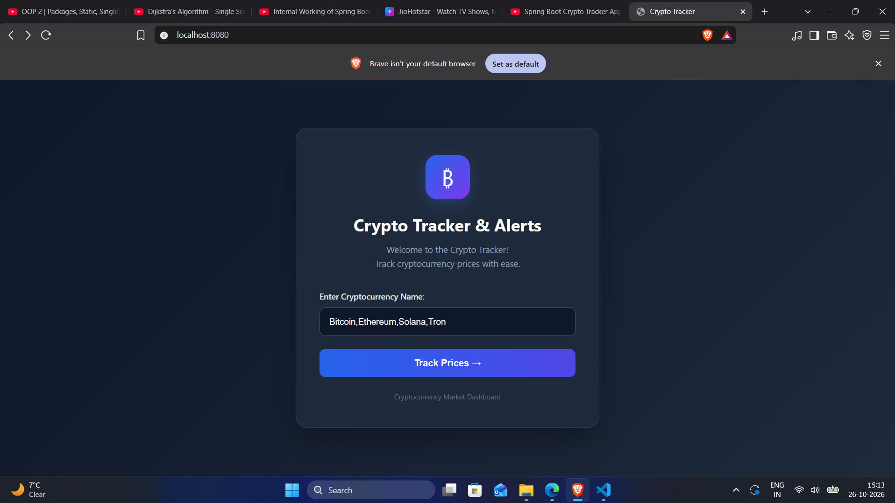
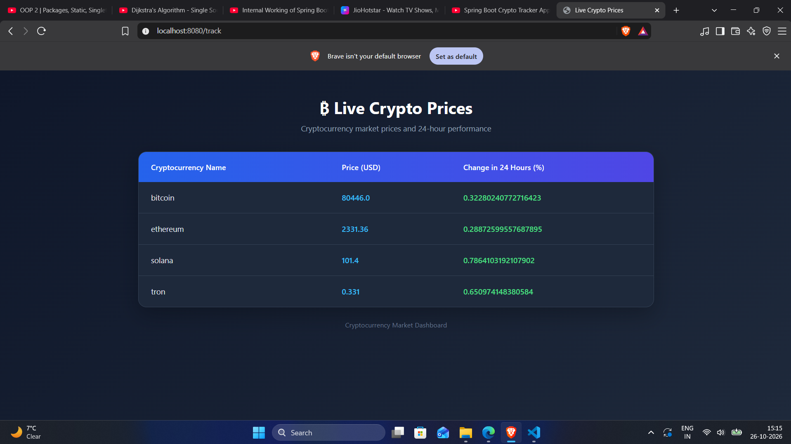

# 💰 CryptoTracker

**CryptoTracker** is a web-based cryptocurrency tracking application developed using Java and Spring Boot. It fetches cryptocurrency market data from the CoinGecko API and displays current prices in USD along with 24-hour price changes through a simple and user-friendly interface.

The application allows users to track multiple cryptocurrencies by entering their CoinGecko IDs, making it easier to monitor cryptocurrency prices in one place.

## 🚀 Features

- **Live Cryptocurrency Prices:** Retrieves cryptocurrency price data using the CoinGecko API.
- **Multiple Cryptocurrency Tracking:** Track multiple cryptocurrencies simultaneously using comma-separated IDs.
- **USD Price Display:** Displays cryptocurrency prices in US dollars.
- **24-Hour Price Changes:** Shows the percentage change in cryptocurrency prices over the last 24 hours.
- **Dynamic Results:** Displays fetched cryptocurrency information in a structured table.
- **User-Friendly Interface:** Provides a clean and responsive interface for searching and viewing cryptocurrency data.
- **Spring Boot Backend:** Processes requests and retrieves data from an external API.
- **JSON Processing:** Converts API responses into Java objects for display.

## 🛠️ Technologies Used

- **Java** – Core programming language.
- **Spring Boot** – Backend application framework.
- **Spring MVC** – Handles HTTP requests and controller operations.
- **Thymeleaf** – Renders dynamic HTML pages.
- **HTML5** – Structures the web pages.
- **CSS3** – Styles the application interface.
- **CoinGecko API** – Provides cryptocurrency market data.
- **RestTemplate** – Sends HTTP requests to the external API.
- **JSON** – Processes cryptocurrency API responses.
- **Maven** – Manages project dependencies and builds.

## 📸 Screenshots

### 1. Search Page

The search page provides a simple interface where users can enter one or more cryptocurrency IDs to retrieve their current market prices and price changes.



### 2. Results Page

The results page displays the retrieved cryptocurrency information in a structured table, including cryptocurrency names, current prices in USD, and 24-hour price changes.



## 📂 Project Structure

```text
CryptoTracker/
│
├── src/
│   └── main/
│       ├── java/
│       │   └── com/
│       │       └── CryptoTracker/
│       │           └── CryptoTracker/
│       │               ├── CryptoController/
│       │               │   └── CryptoController.java
│       │               ├── CryptoService/
│       │               │   └── CryptoService.java
│       │               └── model/
│       │                   └── CryptoCoin.java
│       │
│       └── resources/
│           ├── templates/
│           │   ├── index.html
│           │   └── result.html
│           └── application.properties
│
├── ScreenShots/
│   ├── Search_Page.png
│   └── Result_Page.png
│
├── pom.xml
└── README.md
```

*Note: This represents the expected main project structure. Adjust file names or paths if your actual project differs.*

## ⚙️ Installation and Setup

### Prerequisites

Ensure the following software is installed:

- Java JDK
- Maven
- An IDE such as IntelliJ IDEA, Eclipse, or Spring Tool Suite
- A modern web browser
- An active internet connection

### Step 1: Clone the Repository

```bash
git clone https://github.com/madhurkamble/CryptoTracker.git
```

### Step 2: Navigate to the Project Directory

```bash
cd CryptoTracker
```

### Step 3: Build the Project

```bash
mvn clean install
```

### Step 4: Run the Application

```bash
mvn spring-boot:run
```

Alternatively, run the main Spring Boot application class from your IDE.

### Step 5: Open the Application

Open your browser and visit:

```text
http://localhost:8080
```

## 🔍 How to Use

1. Start the CryptoTracker application.
2. Open the application in your web browser.
3. Enter the cryptocurrency IDs in the search field.
4. To track multiple cryptocurrencies, separate their IDs with commas.
5. Submit the form to retrieve the data.
6. View the cryptocurrency prices and 24-hour price changes on the results page.

**Example input:**

```text
bitcoin,ethereum,dogecoin
```

Some supported CoinGecko IDs include:

| Cryptocurrency | CoinGecko ID |
|---|---|
| Bitcoin | `bitcoin` |
| Ethereum | `ethereum` |
| Dogecoin | `dogecoin` |
| Solana | `solana` |
| XRP | `ripple` |
| Cardano | `cardano` |
| Litecoin | `litecoin` |
| BNB | `binancecoin` |

Use valid CoinGecko IDs instead of ticker symbols such as `BTC` or `ETH`.

## 🌐 API Integration

CryptoTracker uses the CoinGecko Simple Price API to retrieve cryptocurrency market information.

**API endpoint:**

```text
https://api.coingecko.com/api/v3/simple/price
```

**Example request:**

```text
https://api.coingecko.com/api/v3/simple/price?ids=bitcoin,ethereum&vs_currencies=usd&include_24hr_change=true
```

The API provides:

- Cryptocurrency IDs
- Current prices in USD
- Percentage price changes over the last 24 hours

The availability of data and request limits depend on CoinGecko's API service.

## 🔄 Application Workflow

1. The user enters cryptocurrency IDs through the web interface.
2. The Spring Boot controller receives the submitted form data.
3. The controller passes the IDs to the service layer.
4. The service sends an HTTP request to the CoinGecko API using `RestTemplate`.
5. The API returns cryptocurrency data in JSON format.
6. The service processes the response and creates `CryptoCoin` objects.
7. The controller adds the retrieved data to the Spring MVC model.
8. Thymeleaf renders the results page and displays the cryptocurrency information.

## ✨ Key Highlights

- Integrates a third-party REST API into a Java web application.
- Demonstrates the MVC architecture using Spring Boot.
- Uses Thymeleaf to display dynamic data.
- Processes JSON responses from an external API.
- Supports multiple cryptocurrency IDs in one request.
- Separates controller, service, and model responsibilities.
- Provides practical experience with backend development and API integration.

## 🔮 Future Enhancements

- Add interactive cryptocurrency price charts.
- Display cryptocurrency logos and market capitalization.
- Implement automatic price refresh.
- Add cryptocurrency search suggestions.
- Introduce historical price tracking and trend analysis.
- Implement watchlists and favorite cryptocurrencies.
- Improve error handling and loading indicators.

## 👨‍💻 Author

**Madhur Kamble**

- GitHub: [madhurkamble](https://github.com/madhurkamble)
- LinkedIn: [Madhur Kamble](https://www.linkedin.com/in/madhur-kamble-55911b290)
- Project Repository: [CryptoTracker](https://github.com/madhurkamble/CryptoTracker)

## 📄 License

This project is developed for educational and learning purposes. It can be extended and customized for further development.
